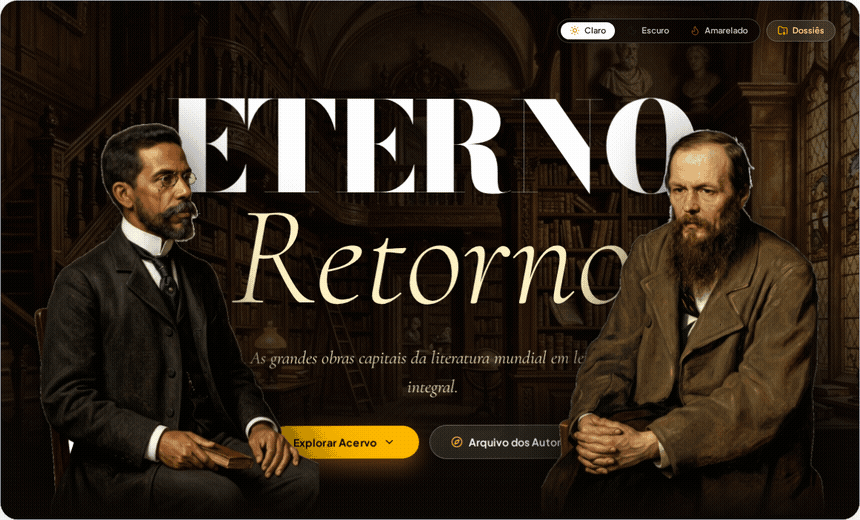
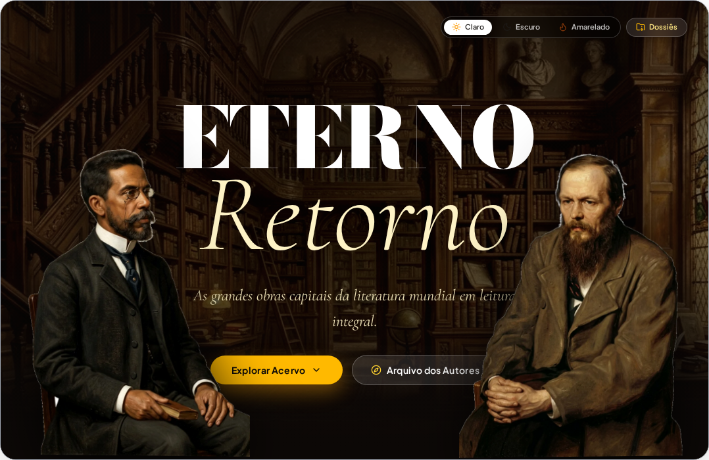
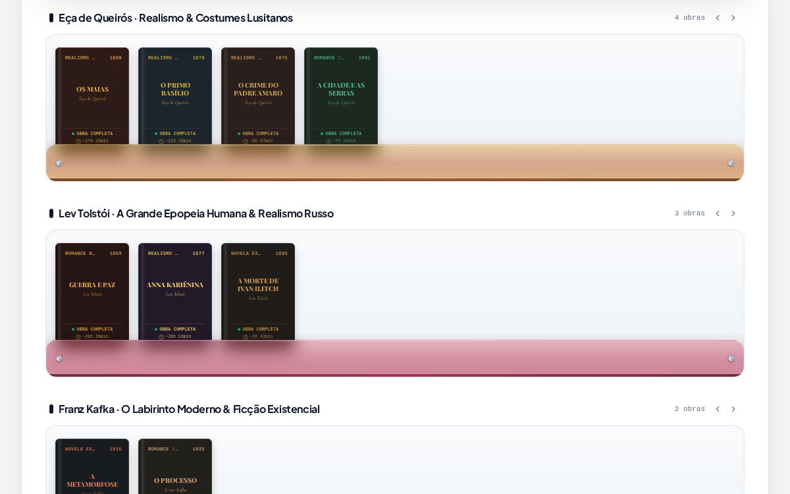
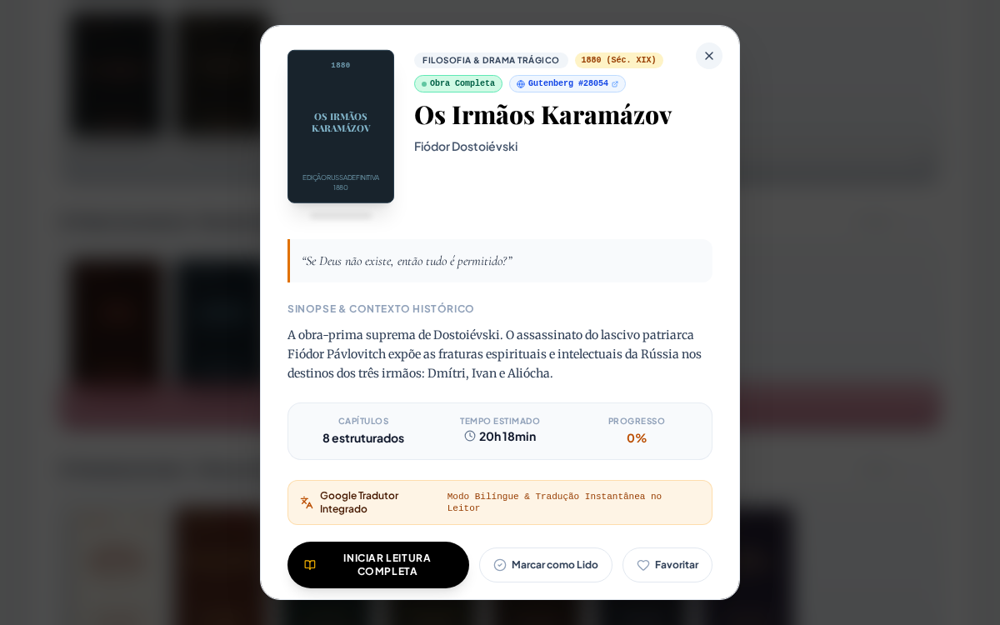
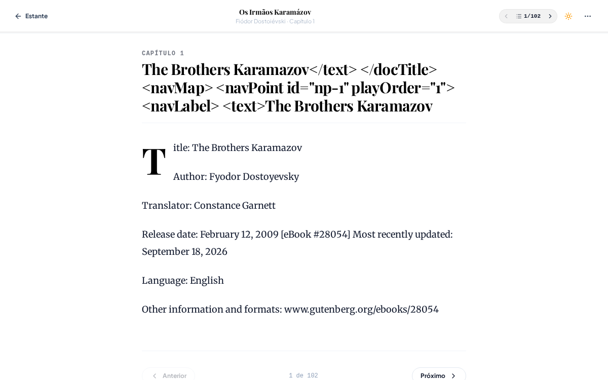
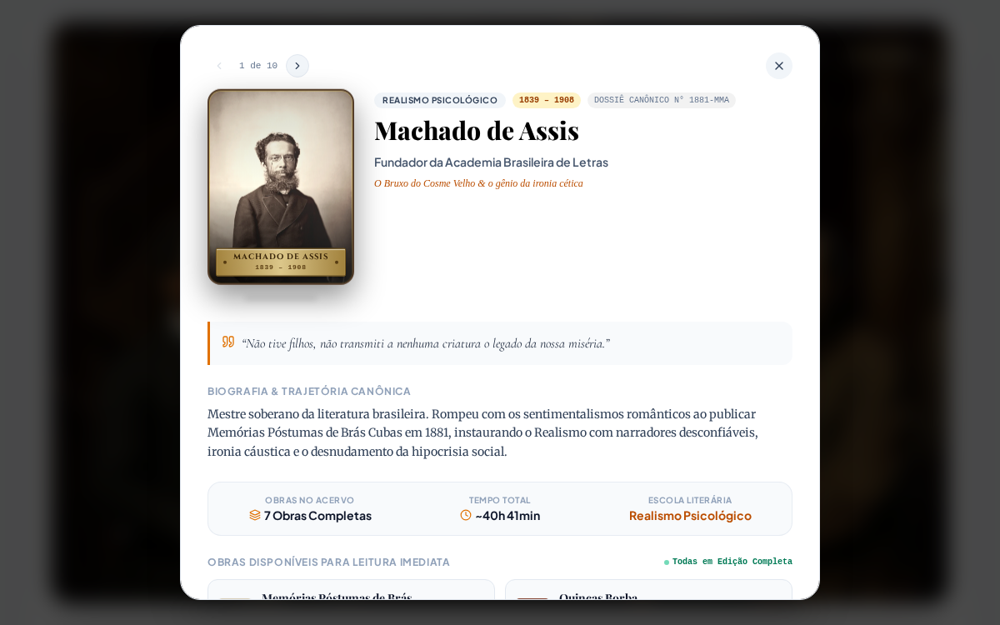

<div align="center">

# Eterno Retorno
### Biblioteca Clássica & Leitor Imersivo da Literatura Universal

[](https://www.typescriptlang.org/)
[](https://react.dev/)
[](https://tailwindcss.com/)
[](https://vitejs.dev/)
[](https://web.dev/progressive-web-apps/)
[](LICENSE)

<br/>

Plataforma de preservação cultural e leitor imersivo da literatura clássica universal e lusófona. O projeto combina estética neoclássica e renascentista, estantes tridimensionais de madeira e acrílico, fichário de autores, motor nativo de leitura EPUB 3.0 e sistema de tradução contextual no próprio dispositivo.

<br/>

<!-- Animação real em GIF do Hero com efeito Parallax suave dos personagens -->


</div>

---

## Sumário

1. [Sobre o Projeto](#sobre-o-projeto)
2. [Demonstração da Interface Real](#demonstração-da-interface-real)
3. [Recursos Principais](#recursos-principais)
4. [Catálogo Completo de Obras](#catálogo-completo-de-obras)
5. [Sistema de Tradução no Dispositivo](#sistema-de-tradução-no-dispositivo)
6. [Arquitetura e Organização do Código](#arquitetura-e-organização-do-código)
7. [Tecnologias Utilizadas](#tecnologias-utilizadas)
8. [Instalação e Execução Passo a Passo](#instalação-e-execução-passo-a-passo)
9. [Suporte Offline (PWA)](#suporte-offline-pwa)
10. [Licença](#licença)

---

## Sobre o Projeto

O **Eterno Retorno** foi idealizado para proporcionar uma experiência de leitura que resgata a nobreza dos livros físicos, integrando recursos modernos do ecossistema web:

- **Obras Integrais**: 37 livros completos com capítulos canônicos e diagramação cuidadosa.
- **Leitor Adaptativo**: Controle de fonte, espaçamento, temas de iluminação (Claro, Escuro e Amarelado) e dicionário interativo do século XIX.
- **Tradução Local**: Capacidade de traduzir parágrafos e capítulos de obras originalmente em outras línguas (russo, alemão) direto no navegador do leitor.
- **Paisagens Sonoras Acústicas**: Sons ambientes de chuva na janela, biblioteca antiga, lareira e salão clássico gerados diretamente por áudio procedural.

---

## Demonstração da Interface Real

Abaixo estão as capturas diretas da aplicação em funcionamento:

### 1. Banner Hero com Efeito Parallax e Seleção de Temas
Composição visual com plano de fundo de biblioteca clássica, iluminação suave e personagens históricos (Machado de Assis e Fiódor Dostoiévski) que reagem ao movimento do mouse com rotação e profundidade.



---

### 2. Estantes de Acrílico e Organização por Autores
Visualização moderna em estantes de acrílico translúcido com fixações metálicas, capas estilizadas, contagem de páginas e estimativa do tempo de leitura.



---

### 3. Modal Editorial da Obra
Ao clicar em qualquer livro, o leitor tem acesso a citações marcantes, sinopse, dados históricos, indicação de tradução integrada e botão para iniciar a leitura.



---

### 4. Leitor Imersivo em Modo Noturno e Ajustes de Leitura
Ambiente de leitura sem distrações com tipografia nítida, aviso de tradução ativa, seleção de tamanho de fonte, ambiência sonora e opções de download em EPUB e PDF editorial.



---

### 5. Dossiês Biográficos e Arquivo dos Autores
Dossiês completos com dados históricos, contexto literário, retrato biográfico e lista cronológica das publicações de cada autor.



---

## Recursos Principais

### Motor EPUB 3.0 Nativo
- Descompactação em tempo real via JSZip e parser DOM de manifestos OPF e arquivos XHTML.
- Paginação precisa com cálculo dinâmico baseado no tamanho da tela do dispositivo.
- Salvamento automático da posição de leitura e percentual concluído no armazenamento local (`localStorage`).

### Tradução no Dispositivo do Usuário
- Para leitores que acessam obras de autores estrangeiros (Dostoiévski, Tolstói e Kafka), o leitor permite alternar entre a versão traduzida e o original.
- O processo é feito por parágrafos para não quebrar a estrutura literária ou o ritmo dos diálogos.

### Dicionário do Século XIX
- Dicionário embutido com centenas de verbetes e arcaísmos presentes na literatura oitocentista.
- Ao selecionar ou tocar nas palavras destacadas, uma janela contextual exibe a etimologia e o significado na época em que a obra foi escrita.

### Modos Visuais e Ergonomia de Leitura
- **Modo Claro**: Fundo pergaminho suave para leitura em ambientes bem iluminados.
- **Modo Escuro / Noturno**: Fundo preto azulado com contraste atenuado para leitura noturna sem fadiga ocular.
- **Modo Amarelado (Âmbar)**: Filtro de luz azul, ideal para descanso visual antes de dormir.

---

## Catálogo Completo de Obras

O acervo contém **37 obras integrais**, estruturadas em edições definitivas:

### Literatura Russa
| Autor | Título | Estrutura |
| :--- | :--- | :--- |
| Fiódor Dostoiévski | *Crime e Castigo* | 6 Partes e Epílogo |
| Fiódor Dostoiévski | *Os Irmãos Karamázov* | 12 Livros e Epílogo |
| Fiódor Dostoiévski | *Noites Brancas* | 6 Partes (Noites I a IV e Manhã) |
| Fiódor Dostoiévski | *Memórias do Subsolo* | 2 Partes Completas |
| Fiódor Dostoiévski | *O Idiota* | 4 Partes Completas |
| Lev Tolstói | *Guerra e Paz* | Volumes I a IV e Epílogo |
| Lev Tolstói | *Anna Kariênina* | 8 Partes Completas |
| Lev Tolstói | *A Morte de Ivan Ilitch* | 12 Capítulos Integrais |

### Literatura Brasileira
| Autor | Obras Inclusas |
| :--- | :--- |
| Machado de Assis | *Dom Casmurro*, *Memórias Póstumas de Brás Cubas*, *Quincas Borba*, *O Alienista*, *Esaú e Jacó*, *Memorial de Aires*, *Poesias Completas* |
| Lima Barreto | *Triste Fim de Policarpo Quaresma*, *Recordações do Escrivão Isaías Caminha*, *Clara dos Anjos*, *Os Bruzundangas* |
| Aluísio Azevedo | *O Cortiço*, *O Mulato*, *Casa de Pensão* |
| José de Alencar | *O Guarani (Volumes I e II)*, *Iracema*, *Senhora*, *Lucíola* |
| Raul Pompéia | *O Ateneu*, *Canções Sem Metro* |
| Castro Alves | *O Navio Negreiro*, *Espumas Flutuantes*, *Vozes d’África* |

### Literatura Portuguesa e Clássicos Mundiais
| Autor | Obras Inclusas |
| :--- | :--- |
| Eça de Queirós | *Os Maias*, *O Primo Basílio*, *O Crime do Padre Amaro*, *A Cidade e as Serras* |
| Franz Kafka | *A Metamorfose* (3 Capítulos), *O Processo* (10 Capítulos) |

---

## Sistema de Tradução no Dispositivo

Para garantir acessibilidade a leitores de diferentes países e dispositivos:

1. **Detecção e Ajuste**: Ao abrir uma obra russa ou de outra língua de origem, o aplicativo verifica se a visualização traduzida está selecionada.
2. **Tradução por Blocos de Parágrafos**: O texto é processado de forma granular, mantendo as quebras de linha e a pontuação originais.
3. **Memória de Cache**: Parágrafos já traduzidos ficam armazenados na sessão, evitando requisições repetidas e permitindo leitura fluida mesmo com oscilações de internet.

---

## Arquitetura e Organização do Código

```text
eterno-retorno/
├── docs/                           # Documentação e recursos visuais
│   └── images/
│       ├── hero-animation.gif      # GIF com a animação real dos personagens no Hero
│       ├── real-hero-banner.png    # Captura da interface do Hero
│       ├── real-acrylic-shelves.png# Captura das estantes de acrílico
│       ├── real-book-modal.png     # Captura do modal editorial do livro
│       ├── real-reader-view.png    # Captura do leitor imersivo em modo escuro
│       └── real-author-dossiers.png# Captura do arquivo de dossiês dos autores
├── public/
│   ├── assets/
│   │   ├── epubs/                  # Arquivos .epub das 37 obras completas
│   │   ├── authors/                # Retratos biográficos em alta resolução
│   │   └── hero/                   # Texturas e recortes em PNG dos autores
│   └── icon.svg                    # Ícone vetorial da biblioteca
├── scripts/                        # Scripts de automação e geração de dados
│   ├── record_hero_and_screenshots.js # Automação Playwright para capturas
│   ├── generate_russian_classics_full.py
│   └── generate_brazilian_classics_full.py
├── src/
│   ├── components/
│   │   ├── Bookshelf/              # Estante 3D de madeira com lombadas em couro
│   │   ├── Home/                   # Componentes da página inicial e busca
│   │   ├── Layout/                 # Barra superior e rodapé
│   │   ├── Modal/                  # Modais editoriais do livro e do autor
│   │   ├── Navigation/             # Barra de navegação inferior
│   │   ├── PWA/                    # Gerenciador de instalação e offline
│   │   ├── Quotes/                 # Gerador de cartões de citação compartilháveis
│   │   ├── Reader/                 # Leitor minimalista, dicionário e tradutor
│   │   └── Showcase/               # Hero Parallax e vitrine acrílica
│   ├── data/
│   │   ├── catalog.ts              # Catálogo unificado com todas as 37 obras
│   │   └── glossary19thCentury.ts  # Glossário oitocentista com centenas de verbetes
│   ├── services/
│   │   ├── ambientAudioService.ts  # Sintetizador procedural de áudio ambiente
│   │   └── translatorService.ts    # Serviço de tradução bilíngue
│   ├── utils/
│   │   ├── editorialPdfGenerator.ts# Diagramador de PDF para impressão
│   │   ├── epubLoader.ts           # Descompressor e analisador de EPUBs
│   │   └── readingTime.ts          # Algoritmo de cálculo de tempo de leitura
│   ├── App.tsx                     # Ponto central de estado e roteamento
│   ├── index.css                   # Tailwind CSS v4 e temas de leitura
│   └── main.tsx                    # Inicialização do React 19
├── package.json                    # Dependências e comandos do projeto
└── vite.config.ts                  # Configuração do Vite e PWA
```

---

## Tecnologias Utilizadas

- **React 19**: Biblioteca base para a interface reativa e modular.
- **TypeScript 5**: Tipagem estrita em todo o fluxo de dados, catálogo e leitores.
- **Tailwind CSS v4**: Motor moderno de estilização utilitária de alto desempenho.
- **Motion**: Biblioteca de animações físicas para transições e o efeito Parallax 3D.
- **Playwright**: Automação de navegadores para testes e captura de imagens reais do sistema.
- **JSZip**: Descompactação nativa de arquivos `.epub` no navegador.
- **jsPDF**: Geração de documentos PDF diagramados no padrão de livro físico.
- **Vite 8**: Servidor de desenvolvimento ultrarrápido e empacotador de produção.

---

## Instalação e Execução Passo a Passo

### Pré-requisitos
- **Node.js** na versão 18 ou superior.
- Gerenciador de pacotes **npm** ou **bun**.

### 1. Clonar o Repositório
```bash
git clone https://github.com/Thiago-devlog/BIblioteca_Eterno_Retorno.git
cd BIblioteca_Eterno_Retorno
```

### 2. Instalar as Dependências
```bash
npm install
```

### 3. Iniciar o Servidor de Desenvolvimento
```bash
npm run dev
```
Abra o navegador no endereço: `http://localhost:3000`

### 4. Compilar para Produção
```bash
npm run build
```
Os arquivos otimizados para publicação em servidor web serão salvos no diretório `dist/`.

---

## Suporte Offline (PWA)

O aplicativo conta com suporte para instalação como aplicativo progressivo (PWA):
- Uma vez aberto no navegador, as obras visitadas e os arquivos da interface são armazenados no cache local via Service Worker.
- O leitor pode utilizar o aplicativo mesmo sem sinal de internet em celulares, tablets ou computadores.
- As anotações, histórico e percentual lido permanecem sincronizados localmente no dispositivo.

---

## Licença

Este projeto está licenciado sob a licença **MIT** — consulte o arquivo [LICENSE](LICENSE) para obter detalhes.  
As obras literárias disponibilizadas no acervo são de **Domínio Público**.
