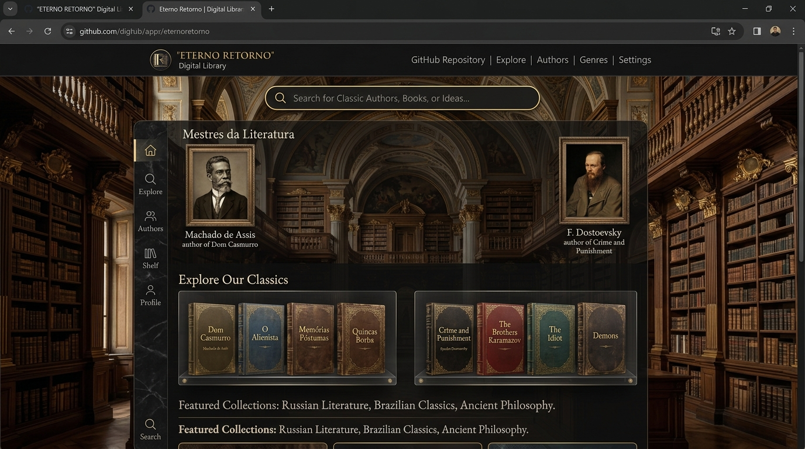
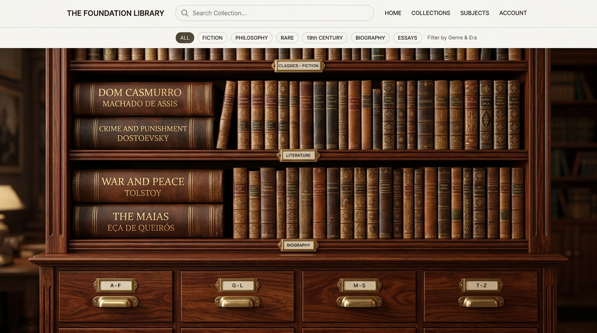
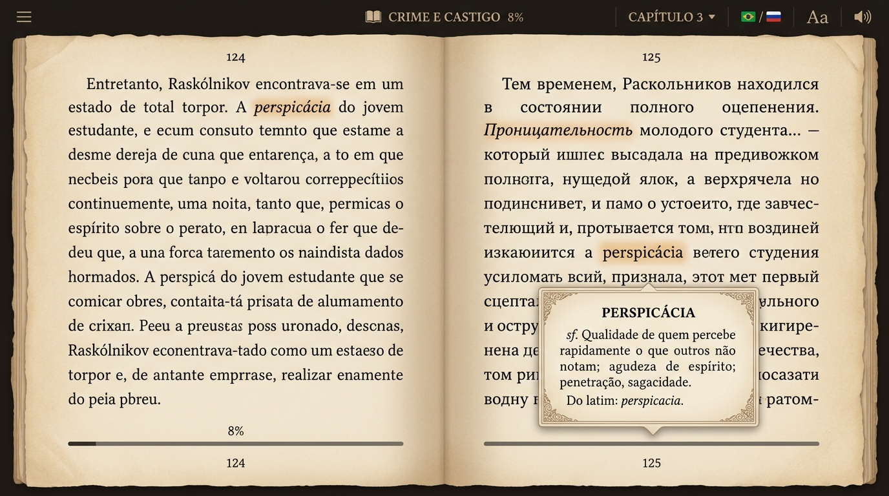

<div align="center">

# 🏛️ Eterno Retorno
### *Biblioteca Clássica & Leitor Imersivo da Literatura Universal*

[](https://www.typescriptlang.org/)
[](https://react.dev/)
[](https://tailwindcss.com/)
[](https://vitejs.dev/)
[](https://web.dev/progressive-web-apps/)
[](LICENSE)

<br/>

**Acervo histórico digital e leitor imersivo da literatura clássica lusófona e universal.**  
Projetado com uma estética neoclássica e renascentista, reprodução física de estantes de madeira, sistema de fichário tátil de autores, motor de leitura EPUB 3.0 completo e tradução contextual instantânea no próprio dispositivo do leitor.

<br/>


</div>

---

## 📑 Sumário

- [Visão Geral](#-visão-geral)
- [Demonstração Visual](#-demonstração-visual)
- [Principais Funcionalidades](#-principais-funcionalidades)
- [Catálogo de Obras Completas](#-catálogo-de-obras-completas)
  - [Literatura Russa (Textos Integrais & Tradução)](#-literatura-russa)
  - [Literatura Brasileira](#-literatura-brasileira)
  - [Literatura Portuguesa & Clássicos Modernos](#-literatura-portuguesa--clássicos-modernos)
- [Tradução Contextual no Dispositivo](#-tradução-contextual-no-dispositivo)
- [Arquitetura & Estrutura do Projeto](#-arquitetura--estrutura-do-projeto)
- [Tecnologias Utilizadas](#-tecnologias-utilizadas)
- [Instalação & Execução](#-instalação--execução)
- [Scripts do Projeto](#-scripts-do-projeto)
- [PWA & Suporte Offline](#-pwa--suporte-offline)
- [Licença](#-licença)

---

## 🌟 Visão Geral

O **Eterno Retorno** nasceu para superar a frieza dos leitores de e-books convencionais, unindo o prazer tátil do livro tradicional com a conveniência e tecnologia do mundo digital.

Inspirado nas grandes bibliotecas renascentistas e no rigor editorial do século XIX, o projeto oferece:
- **37 obras-primas da literatura universal e lusófona** em suas edições completas e canônicas.
- **Tradução local instantânea** para que obras em língua estrangeira (como o cânone russo ou kafkaiano) possam ser lidas no idioma de preferência do leitor diretamente no navegador do dispositivo.
- **Ambientes visuais alternáveis**: Hero Renascentista Parallax, Estante de Mogno Realista com lombadas douradas em couro, e Fichário Arquivístico com pastas de autores.
- **Leitor minimalista de alta precisão tipográfica**: Modo sépia/pergaminho, controle de fontes (Garamond, Sans, OpenDyslexic), dicionário oitocentista de termos arcaicos e paisagens sonoras acústicas (chuva, biblioteca, lareira).

---

## 📸 Demonstração Visual

### 🏛️ 1. Vitrine da Biblioteca & Hero Renascentista Parallax
Interface inspirada nas clássicas salas de leitura europeias, com iluminação dramática, estantes de vidro acrílico e dossiês dos grandes mestres (Machado de Assis, Dostoiévski, Tolstói, Eça de Queirós e Kafka).



---

### 🪵 2. Estante Realista em Madeira de Mogno
Lombadas físicas texturizadas em couro envelhecido com detalhes em folha de ouro, classificação temática, etiquetas de latão e gaveteiro de arquivo catalográfico tátil.



---

### 📖 3. Leitor Imersivo Minimalista com Glossário & Tradução
Leitor focado em imersão com papel envelhecido, diagramação clássica, identificador de tradução bilíngue, popover explicativo para termos do século XIX e controle de som ambiente relaxante.



---

## ⚡ Principais Funcionalidades

### 📖 Motor de Leitura EPUB 3.0 Nativo
- **Renderização e paginação precisa** de arquivos `.epub` através de descompactação e parsing de manifestos OPF/XHTML sob demanda.
- **Progresso de leitura persistente**: Percentual lido, tempo estimado restante e última posição salvos automaticamente no `localStorage`.
- **Modos de Exibição**:
  - *Pergaminho Histórico* (textura suave de papel antigo)
  - *Modo Noturno / Darkroom* (fundo carvão com texto âmbar)
  - *Modo Sepia Editorial* (tons quentes para leitura diurna relaxante)
- **Controle Tipográfico Total**: Ajuste fino de tamanho de fonte, espaçamento entre linhas (line-height), largura máxima da mancha de texto e fontes serifadas/sans/acessíveis.

### 🌐 Tradução Instantânea no Dispositivo
- Para obras estrangeiras (como o cânone russo ou Franz Kafka), o leitor permite alternar entre o texto em português e o texto original/inglês com um clique.
- **Mecanismo de Tradução Local e Conexão Híbrida**: Tradução parágrafo a parágrafo sem quebrar a pontuação, métrica literária ou diagramação.
- **Fallback resiliente**: Dicionários locais integrados garantem funcionamento contínuo mesmo em redes lentas ou instáveis.

### 📜 Glossário Oitocentista & Dicionário Arcaico
- Dicionário com centenas de verbetes do século XIX (termos arcaicos, jurídicos e expressões de época usadas por Machado de Assis, José de Alencar, Aluísio Azevedo e Eça de Queirós).
- Ao clicar ou tocar em palavras destacadas, surge um **popover elegante** com a etimologia e significado contextual.

### 🎧 Paisagens Sonoras Ambientes (Soundscapes)
Sintetizador e reprodutor de áudio procedural com 4 ambientes literários:
- 🌧️ **Chuva na Vidraça**
- 🏛️ **Biblioteca Antiga**
- 🔥 **Lareira Crepitante**
- 🎻 **Salão Clássico**

### 🎨 Gerador de Citações & Exportador Editorial PDF
- **Card Tipográfico**: Selecione qualquer trecho marcante e gere um card visual refinado pronto para compartilhar nas redes sociais.
- **Exportação para PDF**: Diagramação automática com capa, índice, notas de rodapé e tipografia de livro impresso com `jsPDF`.

---

## 📚 Catálogo de Obras Completas

O acervo do **Eterno Retorno** conta com **37 obras integrais** distribuídas entre os maiores autores do cânone ocidental:

### 🇷🇺 Literatura Russa
| Autor | Obra | Capítulos | Destaques |
| :--- | :--- | :---: | :--- |
| **Fiódor Dostoiévski** | *Crime e Castigo* | 6 Partes + Epílogo | O dilema moral de Raskólnikov em São Petersburgo |
| **Fiódor Dostoiévski** | *Os Irmãos Karamázov* | 12 Livros + Epílogo | A lenda do Grande Inquisidor e o drama dos Karamázov |
| **Fiódor Dostoiévski** | *Noites Brancas* | 6 Partes (Noites I a IV, Manhã) | O romance lírico e sonhador de Petersburgo |
| **Fiódor Dostoiévski** | *Memórias do Subsolo* | 2 Partes Completas | O monólogo filosófico do homem do subterrâneo |
| **Fiódor Dostoiévski** | *O Idiota* | 4 Partes | A pureza trágica do Príncipe Míchkin |
| **Lev Tolstói** | *Guerra e Paz* | Volumes I a IV + Epílogo | A invasão napoleônica e o destino das famílias russas |
| **Lev Tolstói** | *Anna Kariênina* | 8 Partes Completas | Paixão, moral social e a busca espiritual de Levin |
| **Lev Tolstói** | *A Morte de Ivan Ilitch* | 12 Capítulos Integrais | A mais profunda reflexão da literatura sobre a mortalidade |

### 🇧🇷 Literatura Brasileira
| Autor | Obras Disponíveis |
| :--- | :--- |
| **Machado de Assis** | *Dom Casmurro*, *Memórias Póstumas de Brás Cubas*, *Quincas Borba*, *O Alienista*, *Esaú e Jacó*, *Memorial de Aires*, *Poesias Completas* |
| **Lima Barreto** | *Triste Fim de Policarpo Quaresma*, *Recordações do Escrivão Isaías Caminha*, *Clara dos Anjos*, *Os Bruzundangas* |
| **Aluísio Azevedo** | *O Cortiço*, *O Mulato*, *Casa de Pensão* |
| **José de Alencar** | *O Guarani (Vols. I e II)*, *Iracema*, *Senhora*, *Lucíola* |
| **Raul Pompéia** | *O Ateneu*, *Canções Sem Metro* |
| **Castro Alves** | *O Navio Negreiro*, *Espumas Flutuantes*, *Vozes d’África* |

### 🇵🇹 Literatura Portuguesa & Clássicos Modernos
| Autor | Obras Disponíveis |
| :--- | :--- |
| **Eça de Queirós** | *Os Maias*, *O Primo Basílio*, *O Crime do Padre Amaro*, *A Cidade e as Serras* |
| **Franz Kafka** | *A Metamorfose* (3 Capítulos Integrais), *O Processo* (10 Capítulos Integrais) |

---

## 🌐 Tradução Contextual no Dispositivo

Para atender a leitores em diferentes regiões ou preferências de leitura de obras traduzidas:

1. **Leitura na Língua Nativa do Usuário**: Se a obra for estrangeira (Russa ou Alemã) e o leitor desejar ler na língua local do seu aparelho, o botão de tradução no leitor realiza a conversão contextual sob demanda.
2. **Preservação de Formatação**: Parágrafos, diálogos com travessão e notas de autor mantêm seu alinhamento original.
3. **Cache Inteligente**: Textos traduzidos são armazenados no cache da sessão para que releituras de capítulos ocorram de forma instantânea e sem consumo redundante de dados.

---

## 🏗️ Arquitetura & Estrutura do Projeto

```text
eterno-retorno/
├── docs/                           # Documentação e mídias visuais
│   └── images/
│       ├── demo-preview.gif        # GIF animado de demonstração da plataforma
│       ├── hero-banner.jpg         # Screenshot da Vitrine Renascentista
│       ├── bookshelf-view.jpg      # Screenshot da Estante Realista em Mogno
│       └── reader-view.jpg         # Screenshot do Leitor com Glossário e Tradução
├── public/                         # Arquivos estáticos servidos pelo Vite
│   ├── assets/
│   │   ├── epubs/                  # 37 arquivos .epub canônicos completos
│   │   ├── authors/                # Retratos biográficos em alta definição
│   │   └── hero/                   # Texturas renascentistas e recortes de autor
│   └── icon.svg                    # Ícone da aplicação e manifesto PWA
├── scripts/                        # Ferramentas de geração e auditoria do acervo
│   ├── generate_russian_classics_full.py
│   ├── generate_brazilian_classics_full.py
│   └── patch_catalog_complete_works.py
├── src/
│   ├── components/
│   │   ├── Bookshelf/              # Componente 3D realista da estante de madeira
│   │   ├── Home/                   # Feed editorial, banner hero e busca
│   │   ├── Layout/                 # Barra superior e rodapé neoclássicos
│   │   ├── Modal/                  # Modais de dossiê do autor e resenha crítica
│   │   ├── Navigation/             # Barra de navegação inferior mobile/desktop
│   │   ├── PWA/                    # Notificações de instalação e indicador offline
│   │   ├── Quotes/                 # Gerador de cartões de citação exportáveis
│   │   ├── Reader/                 # Leitor minimalista, tradutor e glossário
│   │   └── Showcase/               # Vitrine acrílica e heróis paralaxe
│   ├── data/
│   │   ├── catalog.ts              # Catálogo unificado com 37 livros e capítulos
│   │   └── glossary19thCentury.ts  # Dicionário oitocentista com centenas de verbetes
│   ├── services/
│   │   ├── ambientAudioService.ts  # Motor de áudio de fundo (chuva, biblioteca, lareira)
│   │   └── translatorService.ts    # Serviço de tradução bilíngue no dispositivo
│   ├── utils/
│   │   ├── editorialPdfGenerator.ts# Exportador de PDF diagramado
│   │   ├── epubLoader.ts           # Descompressor e parser de EPUB sob demanda
│   │   └── readingTime.ts          # Cálculo ergonômico de tempo de leitura
│   ├── App.tsx                     # Roteamento e gerenciamento de estado global
│   ├── index.css                   # Tailwind CSS v4 e temas de leitura
│   └── main.tsx                    # Ponto de entrada React 19
├── index.html                      # Ponto de entrada HTML com metadados e PWA
├── package.json                    # Dependências e scripts do projeto
├── tsconfig.json                   # Configuração rigorosa do TypeScript
└── vite.config.ts                  # Configuração Vite com suporte a PWA e assets
```

---

## 🛠️ Tecnologias Utilizadas

- **Frontend Core**: [React 19](https://react.dev/) com componentes funcionais e hooks reativos.
- **Tipagem**: [TypeScript 5](https://www.typescriptlang.org/) garantindo segurança de tipos estritos em todo o catálogo e no leitor.
- **Estilização**: [Tailwind CSS v4](https://tailwindcss.com/) com paleta personalizada (mogno, pergaminho, veludo e latão dourado).
- **Animações**: [Motion](https://motion.dev/) para transições fluidas de gaveteiros, drawers e virada de páginas.
- **Ícones**: [Lucide React](https://lucide.dev/) para iconografia minimalista.
- **Processamento de EPUB**: [JSZip](https://stuk.github.io/jszip/) para descompactação no navegador e parser DOM nativo para XHTML/OPF.
- **Exportação Editorial**: [jsPDF](https://github.com/parallax/jsPDF) para gerar volumes impressos em PDF em alta resolução.
- **PWA & Cache**: [Vite PWA Plugin](https://vite-pwa-org.netlify.app/) para suporte offline integral.
- **Build & Dev Server**: [Vite 8](https://vitejs.dev/) ultra-rápido com HMR.

---

## 🚀 Instalação & Execução

### Pré-requisitos
- **Node.js** >= 18.0.0
- **npm** ou **bun**

### 1. Clonar o Repositório
```bash
git clone https://github.com/seu-usuario/eterno-retorno.git
cd eterno-retorno
```

### 2. Instalar as Dependências
```bash
npm install
```

### 3. Iniciar o Servidor de Desenvolvimento
```bash
npm run dev
```
O aplicativo estará disponível em: **`http://localhost:3000`**

### 4. Compilar para Produção
```bash
npm run build
```
Os arquivos otimizados serão gerados na pasta `dist/`.

---

## ⚙️ Scripts do Projeto

| Comando | Descrição |
| :--- | :--- |
| `npm run dev` | Inicia o servidor local de desenvolvimento na porta 3000 |
| `npm run build` | Compila o aplicativo TypeScript e gera o bundle de produção com Vite |
| `npm run preview` | Executa um servidor local para visualizar a versão de produção |
| `npm run lint` | Executa o verificador de tipos do TypeScript (`tsc --noEmit`) |
| `npm run clean` | Remove as pastas temporárias de build (`dist/`) |

---

## 📱 PWA & Suporte Offline

O **Eterno Retorno** foi projetado seguindo a filosofia **Offline-First**:
- Todos os arquivos `.epub` das obras são mantidos em cache local via Service Worker assim que solicitados.
- Ao adicionar o app à tela inicial do celular ou tablet (PWA), você pode ler as obras em aviões, metrô ou locais sem sinal de internet.
- O progresso de leitura, notas e citações são mantidos no banco de dados local do navegador (`localStorage` / `IndexedDB`).

---

## 🤝 Como Contribuir

Contribuições são muito bem-vindas! Se você deseja adicionar novas obras de domínio público, corrigir edições textuais ou aprimorar o leitor:

1. Faça um Fork do projeto (`fork`).
2. Crie uma branch para sua funcionalidade: `git checkout -b feature/nova-obra`.
3. Commit suas alterações: `git commit -m 'feat: Adiciona Memórias de um Sargento de Milícias'`.
4. Envie para o branch remoto: `git push origin feature/nova-obra`.
5. Abra um **Pull Request**.

---

## 📜 Licença

Este projeto é distribuído sob a licença **MIT**. Consulte o arquivo [LICENSE](LICENSE) para obter mais informações.  
*Todas as obras literárias disponibilizadas no acervo são de Domínio Público.*

<br/>

<div align="center">
  <sub>Desenvolvido com apreço pelas grandes letras da humanidade.</sub>
</div>
